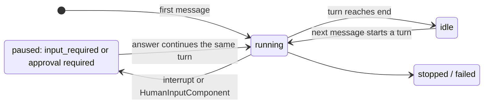

# ADR-001: A conversational session rests as `IDLE` between turns

- Status: accepted
- Date: 2026-11-05
- Deciders: `john-slaughter`, `mikolaj_wawrzyniak` (chat engine), `thomas-schmidt` (Duo Developer)

## Context

Duo Developer sessions started from a mention or an assignment end after one answer. Duo Developer often stops at a
decision only a person can make. For example, it lays out three options and asks "Tell me which one you want", but
the session has already finished, so nobody can answer. The
[epic 24022](https://gitlab.com/groups/gitlab-org/-/work_items/24022) keeps these sessions open, so people can
reply on the session page and the agent continues with its full context.

That needs two things from the platform:

1. **A way for a flow to stay open between turns.** `developer/3.0.0` is an `ambient` flow with one agent that
   completes after one answer. It already has the shape of a `chat-partial` config.
1. **A status for "done for now".** A resting session today shows `INPUT_REQUIRED`. Rails groups that as "needs
   attention" and the status itself sends a to-do and an email. That's right for "waiting on you", but wrong for a
   session that just answered.

The chat engine ([`chat_engine.md`](../chat_engine.md)) already defines turns: a turn is one invocation, the seeded
`end` terminal commits the boundary and writes `INPUT_REQUIRED`, and tool approvals are interrupts inside a turn. A
flow moves to the engine by shipping a new version and listing it in `ENGINE_OWNED_CONFIG_VERSIONS`. Its tracker
([ai-assist issue 2780](https://gitlab.com/gitlab-org/modelops/applied-ml/code-suggestions/ai-assist/-/work_items/2780))
lists the at-rest status as a follow-up.

This is a shared building block, not a Developer-only fix. Chat and Duo in Slack need the same "turn ended, session
open" primitive, and `developer/4.0.0` is the candidate for one Duo Developer definition across CI, the Duo CLI and
the IDE ([epic 23827](https://gitlab.com/groups/gitlab-org/-/work_items/23827)). Duo Developer is the first
consumer. Which version ships on the engine, and what lands before it is listed, is tracked in
[ai-assist issue 3173](https://gitlab.com/gitlab-org/modelops/applied-ml/code-suggestions/ai-assist/-/work_items/3173),
not here.

Constraints:

- Older GitLab versions talk to the same gateway. An older Rails rejects an unknown status event with a 400.
- Older Duo CLI and IDE versions see the same sessions. Older IDEs keep their input locked on an unknown status.
- Existing flows, including customer flows in the AI Catalog, behave exactly as before.
- No new config fields or API fields unless no existing concept covers the need.

## Decision

This ADR decides where a turn ends and how a session rests. How user input reaches and renders in an engine flow is
decided separately, in
[ADR-002](https://gitlab.com/gitlab-org/modelops/applied-ml/code-suggestions/ai-assist/-/merge_requests/7747),
[ADR-003](https://gitlab.com/gitlab-org/modelops/applied-ml/code-suggestions/ai-assist/-/merge_requests/7748) and
[ADR-004](https://gitlab.com/gitlab-org/modelops/applied-ml/code-suggestions/ai-assist/-/merge_requests/7749).

**A turn that ends rests as `IDLE`; a turn that waits stays paused.** The seeded `end` writes `IDLE`, a new
`WorkflowStatusEnum` value, instead of `INPUT_REQUIRED`. `INPUT_REQUIRED` keeps its meaning only for a deliberate
pause inside a turn. A status answers one question: does a person need to act? What a resting session waits for is
data, not a status.

| What happens | Example | Status | Turn |
|---|---|---|---|
| The agent finishes its answer and reaches `end` | "I pushed the fix and opened an MR." | `IDLE` (new) | Ended. The next message starts a new turn. |
| The agent finishes with a question in its answer | "Option A or B? Tell me and I'll make the change." | `IDLE` (new) | Ended. The reply starts a new turn. |
| A tool call needs approval | The agent wants to run `git push` and the rules say "ask". | `TOOL_CALL_APPROVAL_REQUIRED` (unchanged) | Paused. The approval continues the same turn. |
| A flow step deliberately asks for input | A `HumanInputComponent` asks "Approve this plan?", or later an elicitation: a tool asks "Deploy to staging or production?" | `INPUT_REQUIRED` (unchanged) | Paused. The answer continues the same turn. |

`IDLE` is seeded by `ChatGraphBuilder`, so it applies to every engine-listed version, including
`agentic_chat/2.0.0`. There is no per-flow switch. Everything in the engine that treats a rest point specially, such
as stop recovery and entry dispatch, treats `IDLE` the same way.

**`ChatFlow` doesn't wait for `IDLE`.** Older IDEs read a session's status through GraphQL and keep their input
locked on `IDLE` (see below). If that isn't solved when an engine-listed flow reaches the IDE (`agentic_chat/2.0.0`,
or `developer/4.x` as the IDE's default flow), those sessions rest as `INPUT_REQUIRED` through a temporary exception
until it is, for example Rails not declaring `idle_status_event` for IDE sessions. `group::agent developer` owns it,
in [GitLab issue 638556](https://gitlab.com/gitlab-org/gitlab/-/work_items/638556).

**Older consumers keep seeing `INPUT_REQUIRED`.** One module (`duo_workflow_service/status_projection.py`)
translates `IDLE` for consumers that don't know it, using the capability list Workhorse already forwards to the
gateway. GitLab declares `idle_status_event` as a server capability (Workhorse appends it, as it does for
`incremental_checkpoints_only`); a streaming client declares `idle_status`.

| Declared capabilities | Rails status event | Streamed checkpoint status |
|---|---|---|
| none (GitLab 19.5, older Duo CLI or IDE) | `require_input`, as today | `INPUT_REQUIRED`, as today |
| `idle_status_event` (GitLab) | `idle` | `INPUT_REQUIRED` |
| `idle_status` (client) | `require_input` | `IDLE` |
| both | `idle` | `IDLE` |

- The two capabilities are independent. The session page shows the status Rails stores, so a CI session shows
  idle. The Duo CLI in the job doesn't declare `idle_status`, sees `INPUT_REQUIRED` and exits cleanly, so no CLI
  release is needed.
- The translation covers the status event and the stream, not what Rails returns through GraphQL. Older IDEs reload a
  session through GraphQL (`GET_WORKFLOW_EVENTS_QUERY`) and unlock their input only on `INPUT_REQUIRED`, which is why
  IDE sessions wait for them. Language server releases with
  [GitLab Language Server MR 4408](https://gitlab.com/gitlab-org/editor-extensions/gitlab-lsp/-/merge_requests/4408)
  handle `IDLE` and unknown statuses. Developer runs in CI today and isn't affected yet. IDE releases that run the default flow
  GitLab advertises but predate MR 4408 (GitLab Language Server 9.29 and 9.30) are, once that flow is
  `developer/4.x` ([epic 24023](https://gitlab.com/groups/gitlab-org/-/work_items/24023)).

## Consequences

- Flows outside the engine don't change. `chat` and `ambient` flows, including customer flows, keep their statuses.
- An older GitLab that runs an engine-listed version, which only happens through an explicit version pin, sees
  `input_required` with today's to-do.
- Sessions rarely reach `finished`. GitLab separates "a turn ended" from "the session ended" and delivers answers on
  the first.

## Alternatives considered

| Alternative | Why not |
|---|---|
| A `HumanInputComponent` loop on `3.0.0` | The step would need a new field to tell "turn over" from "I'm asking", and it keeps turns as interrupts, diverging from the engine. |
| Change what `end` means for every `chat` flow | Breaks Duo in Slack and customer flows that declare `chat`. |
| Let the agent decide idle vs input required per turn | Puts a platform status into model output. |
| Keep `INPUT_REQUIRED` and let Rails tell the two apart | Rails would have to dig into checkpoint writes for `__interrupt__` (the UI chat log carries it, but only implicitly). A clear status from the gateway was preferred on [ai-assist MR 6772](https://gitlab.com/gitlab-org/modelops/applied-ml/code-suggestions/ai-assist/-/merge_requests/6772). |
| A GitLab version check instead of a capability | Pre-release instances report the previous version (`19.5.0-pre` during 19.6 development). |
| Keep `INPUT_REQUIRED` for chat for good, with a per-flow switch in the builder | A switch per flow for a status that means the same thing everywhere. Chat keeps `INPUT_REQUIRED` only until older IDEs are safe. |
